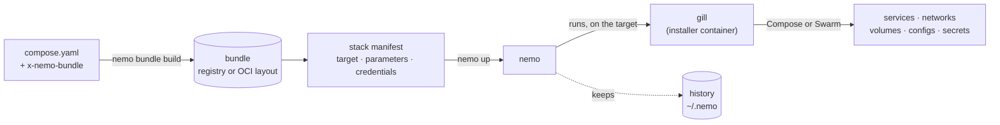

<p align="center">
  
</p>

<h1 align="center">nemo</h1>

<p align="center">
  <strong>Ship applications made of containers to any Docker host, as versioned packages.</strong><br>
  Compose on one machine, Swarm on many: from a laptop, a CI pipeline, or a site with no network.
</p>

<p align="center">
  <a href="https://github.com/sntns/nemo/actions/workflows/ci.yml"></a>
  <a href="https://github.com/sntns/nemo/releases/latest"></a>
  <a href="LICENSE"></a>
  <a href="https://cnab.io"></a>
</p>

<p align="center">
  <a href="docs/getting-started.md">Getting started</a> ·
  <a href="docs/concepts.md">Concepts</a> ·
  <a href="docs/use-cases.md">Use cases</a> ·
  <a href="docs/README.md">Documentation</a> ·
  <a href="docs/reference/cli/nemo.md">CLI reference</a>
</p>

---

Your application is a dozen services described in compose files. Deploying it means building images, pushing them, copying files to servers, running `docker compose up` or `docker stack deploy` in the right order, passing the right secrets, and remembering what is running where. Every team ends up writing that glue, and every environment drifts from the others.

**nemo replaces the glue.** It turns each compose file into a **bundle**: one versioned package that carries the services, their images pinned by digest, and the installer that deploys them. Bundles are grouped into a **stack**, which says where they go and with what settings. `nemo up` brings the target to the stack: in dependency order, with live progress, and with a record of every run.

```console
$ nemo up
shop · swarm · 4 installations

✔ database  install    2 services · 2 volumes · 1 network  9.4s
✔ broker    install    1 service · 1 volume · 1 network   6.1s
⠼ api       install    1/3 services ready  4.2s
    ✔ api-http    ▰▰       2/2   running
    ◌ api-worker  ▰▱       1/2   verifying
    ◌ api-cron    ▱        0/1   preparing
· frontend  install    waiting
```

## Why nemo

- **Keep your compose files.** A bundle is your compose file plus a few lines of metadata. Services, networks, volumes, configs, secrets, healthchecks and `deploy` settings keep their meaning.
- **One package per component, versioned.** Images are pinned by digest inside the bundle: what you tested is exactly what runs, on every node.
- **Stacks instead of scripts.** Declare the components and their dependencies once; nemo installs dependencies first, upgrades what is there, and uninstalls what you removed.
- **Anywhere Docker runs.** Compose on a single host, Swarm on one to many nodes, reached through the local socket, `ssh://`, `tcp://` or a docker context. One bundle runs on all of them unchanged.
- **No registry required.** Copy bundles onto a disk, carry them to a site with no network, and nemo loads their images straight into the target's Docker.
- **Secrets stay where they are.** Credentials are read from files, environment variables or commands when an action runs. nemo never stores them.
- **Know what runs.** `nemo status`, `nemo logs`, and the history of every install, upgrade and uninstall, with its parameters and outputs.
- **Built on standards.** Bundles are [CNAB 1.2](https://cnab.io), stored in any OCI registry or OCI layout. Records follow the CNAB claims specification.

## Install

**Homebrew** (macOS and Linux):

```bash
brew install sntns/tap/nemo
```

**Binaries** for Linux, macOS and Windows, amd64 and arm64, are attached to every [release](https://github.com/sntns/nemo/releases/latest).

**From source**, with Go 1.26 or later:

```bash
go install github.com/sntns/nemo/cmd/nemo@latest
```

nemo talks to Docker through its API: the machine you run it on needs no Docker of its own when the target is remote, only the target runs Docker Engine. For shell completion, see `nemo completion --help`.

## A first deployment in five minutes

The [`examples/hello`](examples/hello) stack has two bundles: `nginx`, which serves a page and a secret, and `whoami`, which depends on it. Build both bundles from their compose files, keep the stack, and bring it up on your local Docker:

```bash
git clone https://github.com/sntns/nemo && cd nemo

nemo bundle build -f examples/hello/nginx/compose.yaml \
  --image nginx:1.27-alpine=docker://nginx:1.27-alpine -o oci:examples/hello/build/nginx.oci
nemo bundle build -f examples/hello/whoami/compose.yaml \
  --image traefik/whoami:v1.10=docker://traefik/whoami:v1.10 -o oci:examples/hello/build/whoami.oci

nemo stack import examples/hello/stack.yaml
export HELLO_TOKEN=s3cret
nemo up
```

```console
$ curl localhost:8080
hello from nemo in eu5
$ nemo status
hello · compose

✔ nginx   1.0.0  installed just now  1/1 services
✔ whoami  1.0.0  installed just now  1/1 services
```

Then change a setting and apply it, follow the logs, and remove everything:

```bash
nemo stack set --param region=eu6 && nemo up    # upgrades both installations
nemo logs nginx -f
nemo down --purge
```

The [getting started guide](docs/getting-started.md) walks through each step.

## How it works



1. **Build.** `nemo bundle build` reads a compose file with an `x-nemo-bundle` block and makes a CNAB bundle: its `${VARIABLES}` become parameters, its secrets become credentials, its images are pinned by digest, and **gill**, nemo's installer, becomes its invocation image. The bundle is written to a registry or to an OCI layout directory, with its images.
2. **Describe.** A stack manifest lists the bundles to install on one target, the target's orchestrator and address, and the parameters and credential sources the bundles need.
3. **Deploy.** `nemo up` orders the bundles by their dependencies, and for each one starts gill on the target with the Docker socket. gill applies the compose project with Compose or Swarm, labels everything it creates, and waits until the services are up. nemo shows the progress and records the run.

There is no server and no agent: nemo keeps its records on the machine it runs on, and gill only lives for the duration of an action. Read [how it works](docs/how-it-works.md) for the details.

## What you can do with it

| You want to | nemo gives you |
|---|---|
| Give every developer the whole platform on their machine | One `nemo up`; `nemo up api` after rebuilding one component |
| Spin up a fresh environment for each pull request | `nemo up` and `nemo down --purge` in CI, with `--json` records |
| Deploy to customer sites, factories, stores, edge boxes | Bundles over `ssh://`, Compose on a single host |
| Run production on a Swarm cluster | Rolling updates, versioned configs and secrets, verified convergence |
| Install where there is no network | `nemo bundle copy` to a disk, `images: load` on the target |
| Ship your software to customers | Versioned bundles they configure with `nemo stack create` |

Each one is described in [use cases](docs/use-cases.md).

## Documentation

| | |
|---|---|
| [Getting started](docs/getting-started.md) | Install nemo and deploy a first stack |
| [Concepts](docs/concepts.md) | Bundles, gill, targets, stacks, installations |
| [How it works](docs/how-it-works.md) | What happens when you build, deploy and remove |
| [Use cases](docs/use-cases.md) | Development platforms, CI, edge, Swarm, offline sites, software vendors |
| [Writing bundles](docs/guides/bundles.md) | From a compose file to a versioned bundle |
| [Managing stacks](docs/guides/stacks.md) | Manifests, parameters, credentials, dependencies, `up` and `down` |
| [Targets](docs/guides/targets.md) | Compose or Swarm, remote Docker, registries or no registry, volume types |
| [Continuous delivery](docs/guides/ci.md) | Build, publish and deploy from a pipeline |
| [Offline sites](docs/guides/offline.md) | Deploy without network or registry |
| [Reference](docs/README.md#reference) | Every command, the manifest, the bundle format, the environment |
| [Comparison](docs/comparison.md) | nemo next to Compose, Swarm stacks, Porter, Helm and scripts |
| [Troubleshooting](docs/troubleshooting.md) | Common errors and how to read them |

## Contributing

Bug reports, ideas and pull requests are welcome: read [CONTRIBUTING.md](CONTRIBUTING.md). Please report security issues privately, as described in [SECURITY.md](SECURITY.md). Everyone taking part follows the [code of conduct](CODE_OF_CONDUCT.md).

## License

nemo is licensed under the [Apache License 2.0](LICENSE). Copyright 2026 Sentiens SAS.

The nemo logo is derived from the Go gopher, designed by [Renée French](https://reneefrench.blogspot.com/) and licensed under [CC BY 4.0](https://creativecommons.org/licenses/by/4.0/). See [docs/assets](docs/assets/README.md).
