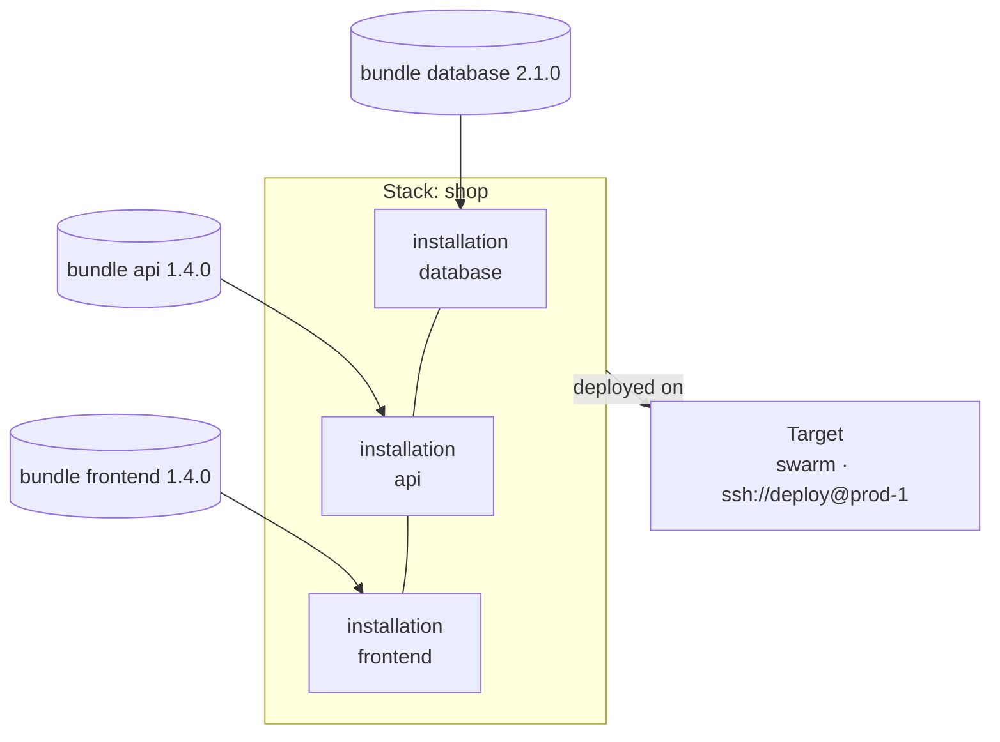

# Concepts

nemo works with five ideas: **bundles** package the components of an application, **gill** installs them, a **target** is where they go, a **stack** says which bundles go to a target and with what, and an **installation** is a bundle installed in a stack.



## Bundle

A bundle is one component of your application, packaged and versioned: a database with its backups, an API with its workers, a web frontend. It is made from a compose file with an `x-nemo-bundle` block that names it:

```yaml
x-nemo-bundle:
  name: api
  version: 1.4.0
services:
  http:
    image: shop-api:latest
  worker:
    image: shop-api:latest
    command: ["worker"]
```

`nemo bundle build` turns it into a [CNAB](https://cnab.io) bundle, which holds:

- **The compose project**, as you wrote it.
- **The images**, each pinned by digest, so that the bundle deploys exactly what was built and tested, on every node.
- **Parameters**: the settings the bundle accepts, from the `${VARIABLES}` of the compose file. `${REGION}` is the `region` parameter.
- **Credentials**: the secrets the bundle needs, from the compose secrets read from a variable. A secret read from `TLS_KEY` is the `tls-key` credential.
- **Dependencies**: the other bundles it needs installed first, with the versions it accepts.
- **The installer**, gill, that knows how to deploy all of it.

A bundle lives in an OCI registry (`docker://registry.example.com/shop/api:1.4.0`), in an OCI layout directory on disk (`oci:build/api.oci`), or as a `bundle.json` file. Its images travel with it in a registry or a layout.

## gill

gill is nemo's installer: the image that every nemo bundle names as its CNAB invocation image, published as `ghcr.io/sntns/gill`. When nemo installs, upgrades or uninstalls a bundle, it starts gill on the target with the target's Docker socket. gill reads the bundle's compose project, fills in the parameters and credentials, and deploys it with the orchestrator the target uses. It keeps no state, and its container is removed when the action ends.

Because gill comes inside the bundle, the target needs nothing installed besides Docker: no agent, no compose plugin, no files.

## Target

A target is where bundles are deployed: one Docker Engine, and the orchestrator that deploys there.

| Setting | What it says | Values |
|---|---|---|
| `orchestrator` | How the bundles are deployed | `compose`: containers on one Docker, as `docker compose up` does. `swarm`: services on a swarm of one or more nodes, as `docker stack deploy` does. |
| `host` or `context` | The Docker to reach | `unix:///var/run/docker.sock`, `ssh://deploy@prod-1`, `tcp://10.0.0.5:2376`, or a docker context. By default, the environment's: `DOCKER_HOST`, the current docker context, or the local socket. |
| `images` | How the images reach the target | `registry`: the target pulls them. `load`: nemo loads them into the target's Docker, with no registry. |
| `volumes` | What each type of volume is made of here | A driver and its options for each type a bundle names: a local volume on a laptop, an NFS share on a cluster. |

The same bundle runs on every target unchanged: the bundle says *what* runs, the target says *where* and *how*.

## Stack

A stack is a set of bundles deployed together on one target, described by a manifest:

```yaml
name: shop
target:
  orchestrator: swarm
  configuration:
    host: ssh://deploy@prod-1
remote: "docker://registry.example.com/shop/{{ .Component }}:{{ .Version }}"
parameters:
  domain: shop.example.com
credentials:
  - name: tls-key
    source: { path: /etc/shop/tls.key }
installations:
  - name: database
    bundle: { version: 2.1.0 }
  - name: api
    bundle: { version: 1.4.0 }
  - name: frontend
    bundle: { version: 1.4.0 }
```

- **`remote`** says where the bundles are: a registry or a directory of OCI layouts, with the bundle's name and version filled in.
- **`parameters`** and **`credentials`** go to every bundle that declares them. An installation can override them with its own.
- **`installations`** lists the bundles to install. Their order does not matter: nemo orders them by their dependencies.

nemo keeps stacks by name in its home, and one of them is the current stack, which commands act on by default. `nemo up` brings the target to the manifest: it installs what is missing, upgrades what is there, and uninstalls what the manifest no longer lists. `nemo down` uninstalls the whole stack.

## Installation

An installation is a bundle installed in a stack, named after the bundle: `shop/api` is the `api` installation of the `shop` stack. Everything gill creates for it is named after the stack and labeled with both names, so nemo can find it again, show its status and logs, and remove exactly what it created.

nemo keeps a record of each installation, as the CNAB specification describes it:

- its **spec**: the bundle, the parameters given, the sources of its credentials (never their values);
- its **status**: the last action and its result, the version installed;
- its **runs**: each install, upgrade and uninstall, with the bundle it ran, its parameters, its result, and its outputs.

`nemo installation list`, `show`, `runs` and `outputs` read these records. The `install`, `upgrade` and `uninstall` commands of `nemo installation` act on one bundle without a manifest: they are the steps `nemo up` and `nemo down` are made of.

## Putting it together

| You run | nemo |
|---|---|
| `nemo bundle build` | Makes a bundle from a compose file, and publishes it with its images |
| `nemo stack create` or `nemo stack import` | Keeps a stack's manifest, and makes it the current stack |
| `nemo up` | Installs and upgrades the stack's bundles on its target, dependencies first, and uninstalls the ones removed from it |
| `nemo status`, `nemo logs` | Reads the services of the stack's installations on the target |
| `nemo down` | Uninstalls the stack, dependants first |
