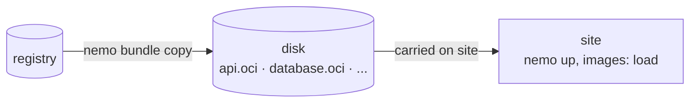

# Offline sites

Some sites have no internet access and no registry: a secure facility, a ship, a remote plant, a customer network that only lets people in. nemo deploys there with the same bundles and the same commands as anywhere else: the bundles travel as directories, and their images are loaded straight into the target's Docker.



## 1. Prepare the delivery

On a connected machine, copy each bundle of the release, with all its images and gill, to an OCI layout directory on the disk you will carry:

```bash
for component in database api frontend; do
  nemo bundle copy "docker://registry.example.com/shop/$component:1.4.0" "oci:/media/delivery/$component.oci"
done
```

A bundle built by your pipeline into OCI layouts (`nemo bundle build -o oci:...`) can be copied as is: it already holds everything.

Add the stack's manifest, without a `remote`: it is given on site. Set `images: load`, since there is no registry to pull from:

```yaml
# /media/delivery/stack.yaml
name: shop
target:
  orchestrator: compose
  configuration:
    images: load
    volumes:
      data:
        driver: local
installations:
  - name: database
    bundle: { version: 2.1.0 }
  - name: api
    bundle: { version: 1.4.0 }
  - name: frontend
    bundle: { version: 1.4.0 }
```

Add the `nemo` binary for the site's platform, from the [release](https://github.com/sntns/nemo/releases/latest) archives. Nothing else is needed: gill is inside each bundle.

## 2. Deploy on site

```bash
nemo stack import /media/delivery/stack.yaml --remote "oci:/media/delivery/{{ .Component }}.oci"
nemo up
```

For each installation, nemo reads the bundle from the disk, loads its images and gill's into the target's Docker, and runs gill. Images are tagged after their digest, so the next delivery never overwrites a running image by mistake.

If the site needs its own settings, a customer's domain, its certificates, give them before `nemo up`:

```bash
nemo stack set --param domain=shop.customer.example --credential tls-key=path:/etc/shop/tls.key
```

Or let the operator on site answer a form: `nemo stack create` lists the bundles of the directory, asks for the target and for everything they declare, and writes the manifest.

## 3. The next delivery

Copy the new versions to a disk, update the versions in the manifest, and run `nemo up` again: nemo upgrades what changed, and keeps the history of both deliveries.

## Limits

- `images: load` sends the images to one Docker: Compose, or a swarm of a single node. A swarm of several nodes needs a registry its nodes can pull from; run one on site and `nemo bundle copy` the bundles into it, then use `images: registry`.
- A dependency that the delivery does not include can't be pulled on site: deliver every bundle the stack needs, dependencies included. nemo looks for dependencies at the stack's `remote` first.
