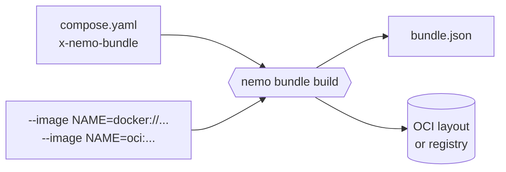
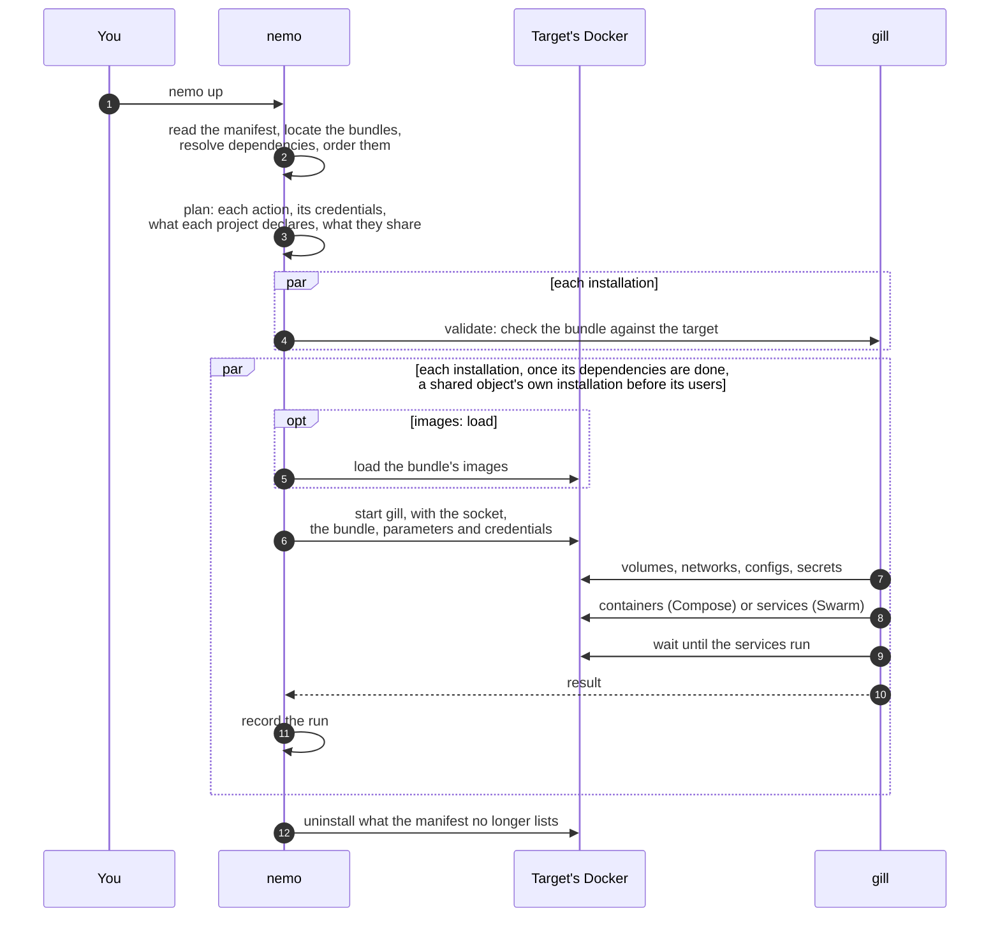

# How it works

nemo has two parts: the `nemo` command, which runs where you are (a laptop, a CI runner), and **gill**, the installer inside every bundle, which runs on the target for the duration of an action. This page follows a bundle from its compose file to running services, and back.

## Building a bundle



`nemo bundle build -f compose.yaml` reads one or more compose files, merged in order, one of which has the `x-nemo-bundle` block. It then:

1. **Reads the metadata** of `x-nemo-bundle`: name, version, description, maintainers, dependencies.
2. **Declares the parameters**: a string parameter for each `${VARIABLE}` of the compose files, with its default when it has one, and for each config read from a variable. `${GATEWAY_HOST}` becomes `gateway-host`.
3. **Declares the credentials**: one for each secret read from a variable, required on install and upgrade.
4. **Pins the images**: for each image of a service, `--image` says where it is (a registry or an OCI layout), and nemo records its digest.
5. **Adds what gill needs**: the compose project in the `io.nemo.compose` extension, the `nemo-*` parameters through which nemo tells gill about the target, and the `io.cnab.docker` extension, which tells any CNAB runtime that the installer needs Docker.
6. **Checks everything at once**: an image with no location, a config or secret read from a file (a bundle carries no files), a parameter named like nemo's own.

With `-o bundle.json`, nemo writes the bundle file. With `-o docker://REFERENCE` or `-o oci:PATH`, it pushes the bundle and all its images, gill's included, the way CNAB tools store bundles in OCI: the images by digest in the bundle's repository, then the bundle itself, tagged with its version.

## Bringing a stack up



**Locating the bundles.** nemo reads the stack's manifest and locates each bundle: a file, a reference in a registry, or a version that the stack's `remote` turns into a location. It reads the bundles' dependencies, and finds those the stack does not list at the stack's remote, else in the registry they name, at the highest version their ranges allow. It orders the installations by level, dependencies first, and by name within a level, and stops before touching anything if a dependency is missing or a range is not met.

**Planning.** Then, still before anything is touched, nemo plans each installation's action:

- The action is `install` if the bundle is not installed in the stack, `upgrade` if it is.
- The parameters are the stack's and the installation's, over what the last run used, limited to those the bundle declares. Credentials are read from their sources now, once: a file, an environment variable, or the output of a command. One that can't be read stops `nemo up` before anything runs.
- nemo renders the installation's compose project with gill's own code, the action's parameters and credentials: it knows every network, volume, config and secret the installation will have on the target, under the name it will have there, and its services and published ports.

The compose project of every installation is named after the stack, so two installations that declare a network or a volume of the same name, or a Swarm config or secret of the same name and content, declare the same object. It is none of theirs, and does not depend on their services: nemo gives it an installation of its own, `network.NAME`, `volume.NAME`, `config.NAME` or `secret.NAME`. Its bundle declares the object alone, with no service, as the first installation that declares it does, with that bundle's gill and nemo-* parameters; a config's or a secret's content reaches it as a credential, never recorded. A network one installation declares otherwise than the first is made as the first declares it, with a warning. What can't be shared stops `nemo up` before anything runs: a service, or a published port, of two installations, and a volume two of them make with other options.

**Each installation.** nemo checks every bundle that has a `validate` action first, all at once. Then each installation runs as soon as those it depends on are done, and the installations of the objects it shares: those come first, and the installations that share nothing don't wait for them. A shared object's installation runs again only when its declaration changes. Nothing else bounds how many run at once.

- With `images: load`, nemo loads the bundle's images into the target's Docker, for its platform only. Each is tagged after its digest, so a new build is a new image. Only an install or an upgrade runs the services: the other actions load gill alone.
- nemo starts gill on the target with the Docker socket mounted, the bundle, the parameters and the credentials, as the CNAB specification describes. It reads gill's events as they come, and shows them.
- gill fills the compose project with the parameters, pins each image to its digest, and applies it with the orchestrator the target names:
  - **Compose** creates the volumes and networks, then the containers, one level of `depends_on` at a time, waiting at each level for the condition the dependants ask for: started, healthy, or completed. A started or healthy container must then stay up for 5 seconds without the daemon restarting it, so that one that starts then exits is caught. A container whose configuration did not change is kept.
  - **Swarm** creates the volumes, networks, configs and secrets, then creates or updates each service, waits until its tasks converge, and watches them for a moment to make sure they stay up. Configs and secrets are named after their content, so a change rolls the services that use them. Swarm can't change the mode of a service, replicated, global or a job: a service whose mode changes is removed, then created again once its containers are gone.
  - Both then remove what the installation no longer declares: its services, configs and secrets, and the networks it created, once nothing uses them.
- nemo records the run: the claim (what ran, with which bundle and parameters), its result, and its outputs.

Once an action fails, `nemo up` starts no other, lets those under way end, and shows gill's error. Otherwise it then uninstalls the installations of the stack that the manifest no longer lists, as `nemo down` does. One that shares a volume with an installation the stack keeps keeps its volumes, even with `--purge`.

Nothing of this is in the bundles: a bundle is a CNAB bundle, which Porter or another CNAB runtime installs alone, its gill creating what it needs.

## Taking it down

`nemo down` uninstalls every installation of the stack from nemo's records: it needs no manifest. An installation goes once those that depend on it are gone, and a shared object's installation once its users are gone, several at once. For each one, gill finds the objects the compose project declares by their names, and removes those that carry the stack's labels, and the configs and secrets its services used, once nothing else uses them. An object with the same name that nemo did not create is left alone, with a warning, and so is a shared object, which its own installation removes once its users are gone. Volumes are kept unless you ask for `--purge`. A network another installation still uses is kept; one nothing uses any more is removed once Swarm released it, which gill waits for, up to 30 seconds.

## Labels and ownership

Everything gill creates carries labels: the stack, the bundle, the service, and a hash of its specification. They let nemo:

- tell its own objects from any other on the same Docker, and refuse to take over a network, volume or service it did not create;
- share what installations share: a network or a volume carries the stack's labels, which every installation of the stack uses, and the bundle's that created it, a shared object's own; a service, config or secret is its installation's;
- keep what did not change on an upgrade, and recreate only what did;
- read the status and the logs of a stack's services;
- stay compatible with Docker's own tools: `docker compose ps` and `docker compose logs` see the containers gill creates, and `docker stack services` the services.

## Where state lives

There is no server. nemo keeps its records in its home directory, `~/.nemo` by default, next to the stacks' manifests:

```
~/.nemo/current                                     the current stack
~/.nemo/<stack>/manifest.yaml                       the stack's manifest, or manifest.json
~/.nemo/<stack>/installations/<name>/installation.json
~/.nemo/<stack>/installations/<name>/runs/          one claim per action
~/.nemo/<stack>/installations/<name>/results/       one result per action
~/.nemo/<stack>/installations/<name>/outputs/       the outputs of each result
```

What runs on the target is described by the labels on the target. What was asked, and what happened, is in these records. Nothing secret is written: credentials are kept by their source, sensitive parameters are never stored, files are readable by their owner only.

## Progress

gill reports what it does as events: images loading, networks and volumes created, and each service's containers (Compose) or tasks (Swarm) counted as they start, pass their health check or are verified to stay up, and run. nemo renders them:

- **in a terminal**, as a view redrawn in place: a title that counts the installations done, at work and waiting, then a line per object installations share and a line per installation, in the stack's order, their columns lined up. An installation at work shows a meter of its services, a square each, up to ten, else each its share of them: green ready, cyan running while Swarm verifies it stays up or Compose checks its health, yellow on its way, red failed, empty not there yet. It unfolds only the services in trouble, failed or restarting: all of them when it is the only one at work, or with `--all`. One that failed unfolds them all, with gill's output;
- **elsewhere**, a CI log for instance, as one line per change;
- **with `--json`**, the records of the runs are also printed on standard output, for scripts.

When an action fails, nemo shows the error of the service that failed and gill's output once, then exits with a non-zero status.
