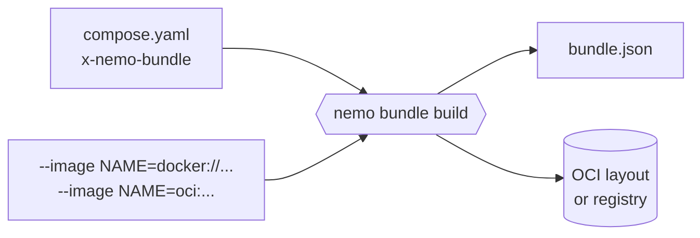
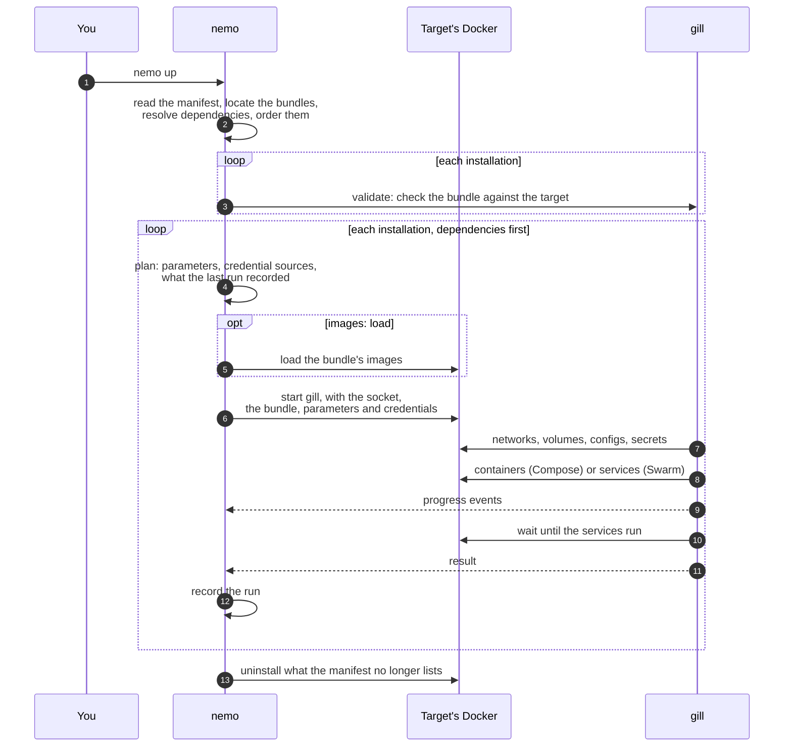

# How it works

nemo has two parts: the `nemo` command, which runs where you are (a laptop, a CI runner), and **gill**, the installer inside every bundle, which runs on the target for the duration of an action. This page follows a bundle from its compose file to running services, and back.

## Building a bundle



`nemo bundle build -f compose.yaml` reads one or more compose files, merged in order, one of which has the `x-nemo-bundle` block. It then:

1. **Reads the metadata** of `x-nemo-bundle`: name, version, description, maintainers, dependencies.
2. **Declares the parameters**: a string parameter for each `${VARIABLE}` of the compose files, with its default when it has one, and for each config read from a variable. `${GATEWAY_HOST}` becomes `gateway-host`.
3. **Declares the credentials**: one for each secret read from a variable, required on install and upgrade.
4. **Pins the images**: for each image of a service, `--image` says where it is (a registry or an OCI layout), and nemo records its digest.
5. **Adds what gill needs**: the compose project in the `io.nemo.compose` extension, the `nemo-*` parameters through which nemo tells gill about the target, and the `io.cnab.docker` extension, which tells any CNAB runtime that the installer needs Docker.
6. **Checks everything at once**: an image with no location, a config or secret read from a file (a bundle carries no files), a parameter named like nemo's own.

With `-o bundle.json`, nemo writes the bundle file. With `-o docker://REFERENCE` or `-o oci:PATH`, it pushes the bundle and all its images, gill's included, the way CNAB tools store bundles in OCI: the images by digest in the bundle's repository, then the bundle itself, tagged with its version.

## Bringing a stack up



**Planning.** nemo reads the stack's manifest and locates each bundle: a file, a reference in a registry, or a version that the stack's `remote` turns into a location. It reads the bundles' dependencies, and finds those the stack does not list at the stack's remote, else in the registry they name, at the highest version their ranges allow. It orders the installations so that dependencies come first, and stops before touching anything if a dependency is missing or a range is not met.

**Each installation.** For each installation, in order:

- The action is `install` if the bundle is not installed in the stack, `upgrade` if it is.
- The parameters are the stack's and the installation's, over what the last run used, limited to those the bundle declares. Credentials are read from their sources now: a file, an environment variable, or the output of a command.
- With `images: load`, nemo loads the bundle's images into the target's Docker, for its platform only. Each is tagged after its digest, so a new build is a new image.
- nemo starts gill on the target with the Docker socket mounted, the bundle, the parameters and the credentials, as the CNAB specification describes. It reads gill's events as they come, and shows them.
- gill fills the compose project with the parameters, pins each image to its digest, and applies it with the orchestrator the target names:
  - **Compose** creates the networks and volumes, then the containers, one level of `depends_on` at a time, waiting at each level for the condition the dependants ask for: started, healthy, or completed. A container whose configuration did not change is kept.
  - **Swarm** creates the networks, volumes, configs and secrets, then creates or updates each service, waits until its tasks converge, and watches them for a moment to make sure they stay up. Configs and secrets are named after their content, so a change rolls the services that use them.
- nemo records the run: the claim (what ran, with which bundle and parameters), its result, and its outputs.

`nemo up` stops at the first installation that fails, and shows gill's error. Then it uninstalls the installations of the stack that the manifest no longer lists, dependants first.

## Taking it down

`nemo down` uninstalls every installation of the stack, dependants first, from nemo's records: it needs no manifest. For each one, gill finds the objects the compose project declares by their names, and removes those that carry the installation's labels. An object with the same name that nemo did not create is left alone, with a warning. Volumes are kept unless you ask for `--purge`. A network another installation still uses is kept.

## Labels and ownership

Everything gill creates carries labels: the stack, the bundle, the service, and a hash of its specification. They let nemo:

- tell its own objects from any other on the same Docker, and refuse to take over a network, volume or service it did not create;
- keep what did not change on an upgrade, and recreate only what did;
- read the status and the logs of a stack's services;
- stay compatible with Docker's own tools: `docker compose ps` and `docker compose logs` see the containers gill creates, and `docker stack services` the services.

## Where state lives

There is no server. nemo keeps its records in its home directory, `~/.nemo` by default, next to the stacks' manifests:

```
~/.nemo/current                                     the current stack
~/.nemo/<stack>/manifest.yaml                       the stack's manifest, or manifest.json
~/.nemo/<stack>/installations/<name>/installation.json
~/.nemo/<stack>/installations/<name>/runs/          one claim per action
~/.nemo/<stack>/installations/<name>/results/       one result per action
~/.nemo/<stack>/installations/<name>/outputs/       the outputs of each result
```

What runs on the target is described by the labels on the target. What was asked, and what happened, is in these records. Nothing secret is written: credentials are kept by their source, sensitive parameters are never stored, files are readable by their owner only.

## Progress

gill reports what it does as events: images loading, networks and volumes created, and each service's containers (Compose) or tasks (Swarm) counted as they start, pass their health check or are verified to stay up, and run. nemo renders them:

- **in a terminal**, as a view redrawn in place: a line per installation, the services of the one at work unfolded;
- **elsewhere**, a CI log for instance, as one line per change;
- **with `--json`**, the records of the runs are also printed on standard output, for scripts.

When an action fails, nemo shows the error of the service that failed and gill's output once, then exits with a non-zero status.
